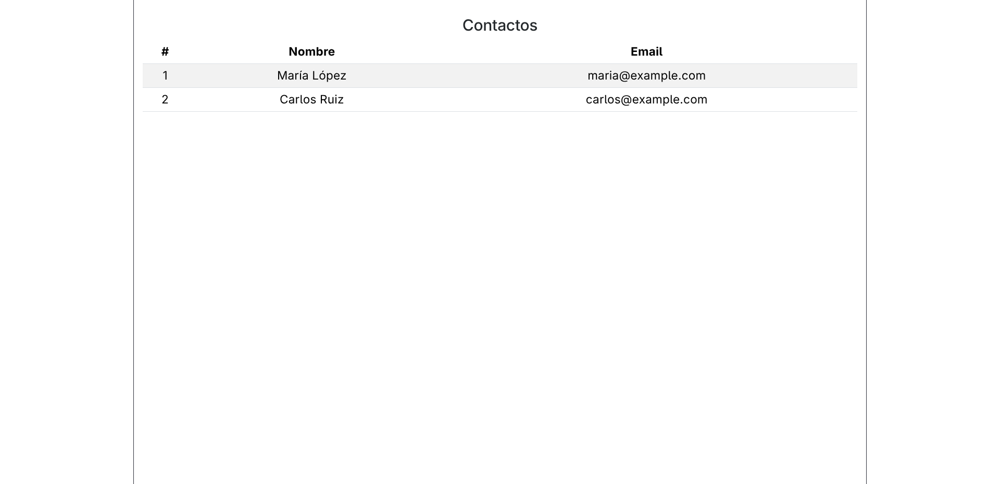
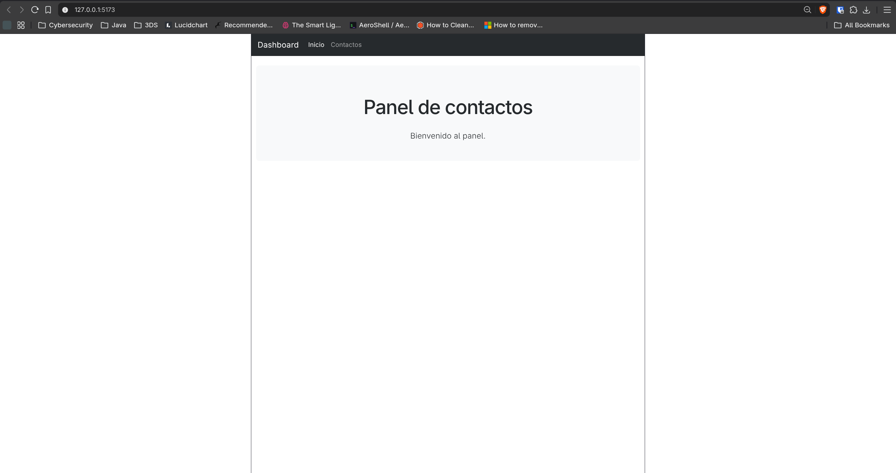
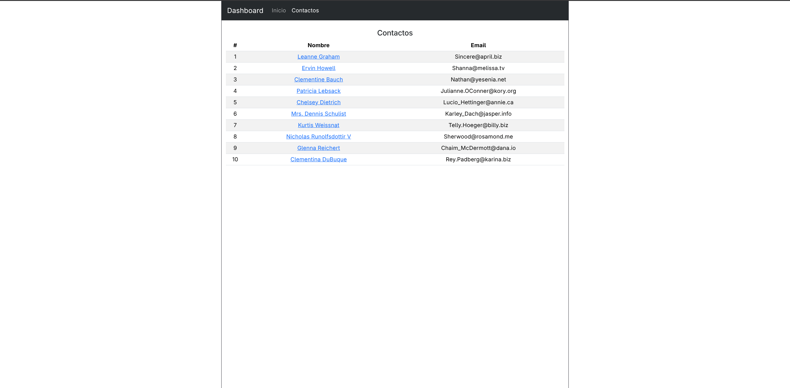
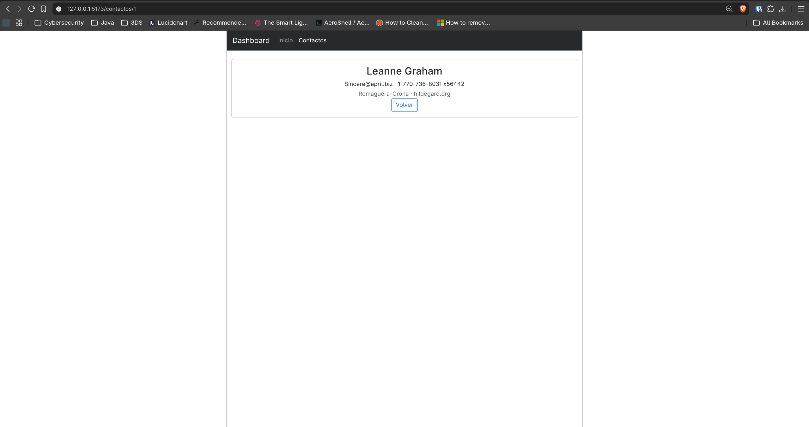
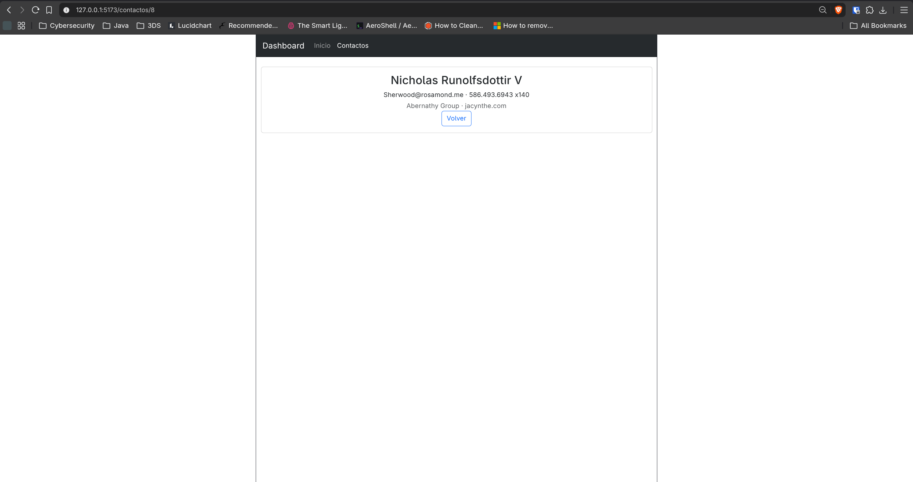
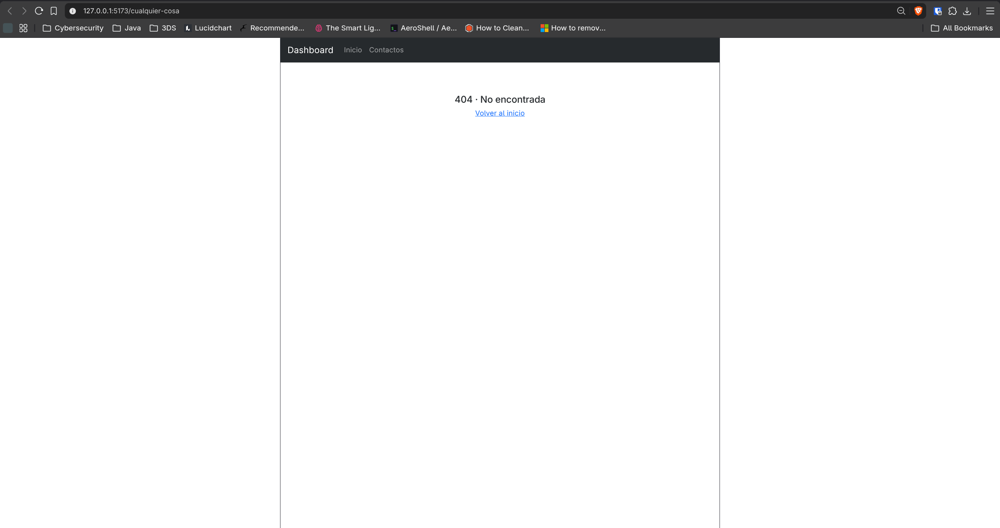

# Taller 5 · React: componentes, Hooks, APIs y rutas

Panel de contactos desarrollado con **React, TypeScript, Vite y Bootstrap**.
La primera parte muestra contactos definidos en el código; la segunda obtiene
los datos desde JSONPlaceholder y permite navegar entre inicio, lista y detalle
sin recargar la página.

> **Objetivo:** practicar componentes y props tipadas, renderizado de listas,
> estado con `useState`, consultas con `useEffect` y `fetch`, y navegación con
> React Router.

## Partes del taller

Repositorio: [taller5-ddaw](https://github.com/jdsotomayorjimenez/taller5-ddaw).

| Rama | Contenido | Capturas |
| --- | --- | --- |
| `taller5-p1` | Primera parte: interfaz `Contact`, componentes `ContactList` y `ContactRow`, y tabla Bootstrap con un arreglo fijo de contactos. Conserva el commit inicial `29eb3b2`. | Captura 1. |
| `taller5-p2` | Segunda parte: continúa la primera y agrega servicio de API, estados de carga y error, páginas, menú y detalle de contacto mediante rutas dinámicas. Incluye esta documentación y las capturas de ambas partes. | Capturas 2 a 6; conserva la captura 1 como referencia de la primera parte. |

Las ramas permiten consultar cada etapa del taller por separado:
`taller5-p1` conserva la versión con contactos locales y `taller5-p2` contiene
la evolución con Hooks, API y navegación. La captura 1 corresponde únicamente
al resultado de la parte 1; desde la captura 2 en adelante se muestra el
resultado de la parte 2. Las secciones de funcionamiento y ejecución de este
README describen la segunda parte.

La segunda parte sigue el material **Programación Web en el Cliente · React ·
Clase 2**, sobre Hooks, APIs y rutas. El PDF de clase se conserva localmente y
no se incluye en el repositorio.

## Cómo funciona

**Navegación:** `Navbar → Link / NavLink → Routes → página`

**Lista:** `ContactList → useEffect → getContacts() → fetch → JSONPlaceholder → useState → ContactRow`

**Detalle:** `Link → /contactos/:id → useParams() → getContact(id) → tarjeta`

| Archivo | Responsabilidad |
| --- | --- |
| `src/main.tsx` | Monta la aplicación, importa Bootstrap y activa `BrowserRouter`. |
| `src/App.tsx` | Muestra el menú en todas las páginas y define las rutas. |
| `src/components/Navbar.tsx` | Enlaces Inicio y Contactos con `NavLink` para resaltar la sección activa. |
| `src/components/ContactList.tsx` | Consulta contactos, muestra carga o error y renderiza la tabla con sus encabezados. |
| `src/components/ContactRow.tsx` | Muestra el ID, el nombre enlazado al detalle y el correo de cada contacto. |
| `src/services/contactService.ts` | Consulta `/users` y `/users/:id`; comprueba `response.ok` y lanza errores HTTP. |
| `src/types/contact.ts` | Define `Contact` y `ContactDetail` para tipar los datos. |
| `src/pages/HomePage.tsx` | Bienvenida al panel. |
| `src/pages/ContactsPage.tsx` | Página que contiene la lista de contactos. |
| `src/pages/ContactDetailPage.tsx` | Lee el ID de la URL y muestra nombre, correo, teléfono, empresa y sitio web. |
| `src/pages/NotFoundPage.tsx` | Página 404 con un enlace para volver al inicio. |

| Ruta | Resultado |
| --- | --- |
| `/` | Inicio del panel. |
| `/contactos` | Lista de contactos de la API. |
| `/contactos/1` | Detalle del contacto con ID 1. |
| `/contactos/8` | Detalle del contacto con ID 8. |
| `/contactos/99` | Alerta de contacto no encontrado cuando la API responde 404. |
| `/cualquier-cosa` | Página 404 de la aplicación. |

## Ejecución

Con Node.js y npm instalados, desde la carpeta del proyecto:

```bash
npm ci
npm run dev
```

Abre [localhost:5173](http://localhost:5173/) en el navegador. Si el puerto está
ocupado, usa la dirección que indique Vite en la terminal. Detén el servidor con
`Ctrl+C`.

La segunda parte necesita conexión a Internet para consultar
[JSONPlaceholder](https://jsonplaceholder.typicode.com/users). No requiere un
backend local ni variables de entorno.

Para visualizar la compilación de producción:

```bash
npm run build
npm run preview
```

Abre la dirección que indique Vite, normalmente
[localhost:4173](http://localhost:4173/).

## Verificación

```bash
npm run lint
npm run build
```

ESLint y la compilación de TypeScript y Vite terminan correctamente.
Las capturas muestran la tabla con diez contactos, el menú, dos páginas de
detalle y la ruta 404. El proyecto no tiene un script de pruebas automatizadas.

En desarrollo, `StrictMode` puede ejecutar los efectos dos veces: es normal
observar dos peticiones a la API al montar el componente.

## Diseño

Se utilizan las clases de Bootstrap para el menú oscuro, la tabla con filas
alternadas, las tarjetas, los botones y las alertas. `src/index.css` conserva
los estilos globales de la plantilla, con contenido centrado y un ancho máximo
para la aplicación.

## Capturas

**Parte 1 · rama `taller5-p1`:** captura 1.

**Parte 2 · rama `taller5-p2`:** capturas 2 a 6.

### 1. Parte 1 · Contactos locales



Estado inicial del taller: `ContactList` recorre un arreglo fijo y pasa cada
contacto a `ContactRow` mediante props. Todavía no hay API ni rutas.

### 2. Parte 2 · Inicio del panel



El menú se muestra junto con las rutas en un único `return` de `App.tsx`.
Se eliminó el segundo `return`, que impedía renderizar `Navbar`.

### 3. Parte 2 · Contactos desde la API



El servicio sustituye el arreglo local por datos obtenidos con `fetch`.
La tabla conserva los encabezados `#`, `Nombre` y `Email`, y cada nombre enlaza
al detalle correspondiente.

### 4. Parte 2 · Detalle del contacto 1



La ruta `/contactos/1` utiliza `useParams()` para consultar el contacto y mostrar
sus datos. El botón Volver lleva a `/contactos`.

### 5. Parte 2 · Detalle del contacto 8



La misma página presenta otro contacto al acceder a `/contactos/8`, usando el
parámetro dinámico de la URL.

### 6. Parte 2 · Página no encontrada



La ruta `*` muestra esta página cuando la URL no coincide con las rutas del
panel.
